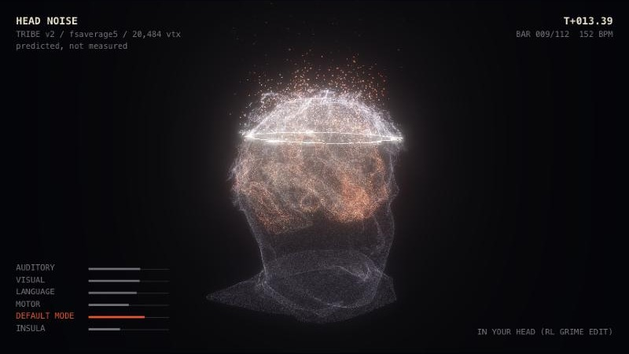

# Head Noise

**Upload a track and a photo of a face. Head Noise turns the face into a 3D head, slices the top off, and shows a
predicted brain reacting to the music out of the opening, then lets you export the visual as a video.**

The heavy steps run as ComfyUI workflows driven by the [Comfy SDK](https://pypi.org/project/comfy-sdk/), on a local
ComfyUI, a serverless deployment on the Comfy developer platform, or Comfy Cloud. Every model is open weights: no
partner (API) nodes anywhere.



---

## What it does

1. **Track in.** Drop any audio file. The browser decodes it and computes a 60 fps DSP envelope (RMS plus low, mid
   and high bands, and kick onsets).
2. **TRIBE v2.** Meta FAIR's [TRIBE v2](https://github.com/facebookresearch/tribev2) brain-encoding model predicts the
   fMRI response to the audio on the fsaverage5 cortex: 20,484 surface vertices, one frame per second.
3. **Face in, head out.** A front-facing face photo goes through BiRefNet (background removal) and
   [Hunyuan3D 2.1](https://huggingface.co/tencent/Hunyuan3D-2.1) (image to 3D) in ComfyUI. The mesh comes back as a
   GLB, and the app fits the cortex inside its cranium.
4. **Viewer.** The head is drawn as point dust with its top sliced off. The cortex inside lights up from the TRIBE
   prediction, pulses with the music, and throws sparks out of the cut. Export the snippet or the full track as
   MP4/WebM at 16:9, 9:16 or 1:1.

## Status: what is real and what is cached

| Step | Where it runs | Status |
|---|---|---|
| Decode + DSP envelope | browser | Real, for any track. |
| TRIBE v2 | `TribeV2Predict` node in ComfyUI | **Cached.** TRIBE v2 needs ~28 GB and minutes per track, so for the demo the node serves a run made offline (`tools/tribe_probe.py`), picked by matching the track length, with paced progress. Any other track plays over that run. Live inference would only replace `_predict()` in the node. |
| Face to 3D | ComfyUI: BiRefNet + Hunyuan3D 2.1 | Real. About 2.5 to 3 min on an M5 Pro (MPS); much faster on a datacenter GPU. |
| Head fit | browser (`app/src/headfit.js`) | Real. Scales the mesh so its cranium wraps the cortex with ~13 mm of scalp and skull. |
| Viewer + export | browser (Three.js, MediaRecorder) | Real. Export records in real time. |
| Full-track render on the GPU | | Not yet: rendering happens locally in the browser. |

---

## How it works

```
 browser (app/)                         backend (comfy/server/app.py)                 ComfyUI (Comfy API v2)
 ─────────────                          ─────────────────────────────                 ─────────────────────
 track ──► decode + DSP envelope
 track, face, duration ── POST /api/runs ──► comfy_sdk.AsyncComfy
                                              ├─ tribe_v2_api.json   ── submit ──►  LoadAudio ► TribeV2Predict ► .tribe
                                              └─ face_to_3d_api.json ── submit ──►  LoadImage ► BiRefNet ► face on white
                                                                                    ► Hunyuan3D 2.1 ► VoxelToMesh
                                                                                    ► HeadNoiseSaveMesh ► .glb
 pipeline list  ◄── SSE progress ──────────── job.events()
 cortex         ◄── preds.tribe ───────────── output.to_file()
 head (swap)    ◄── head.glb ─────────────────
 viewer ──► MediaRecorder ──► MP4 / WebM
```

- **The backend** (FastAPI) uploads the inputs as assets, submits both workflows, follows each job's event stream, and
  downloads the outputs. Playback starts as soon as TRIBE is done; the generated head swaps in when Hunyuan3D finishes.
- **The SDK code is the same for every target.** Only `COMFY_BASE_URL` and `COMFY_API_KEY` change (see
  [Configuration](#configuration)).
- **If the backend is unreachable,** the app falls back to the bundled TRIBE run and the default head, so the viewer
  still works offline.

### Two clocks drive the brain

| Clock | Rate | Source | Drives |
|---|---|---|---|
| Slow | 1 Hz, smoothstepped | TRIBE v2 z-scores per vertex | Activation colour (cream to red-orange) and brightness of each of the 20,484 vertices |
| Fast | 60 fps | DSP envelope | Pulses per region: auditory with the kick band, visual with the highs, motor and insula with the mids; sparks spawn on kicks from active crown vertices |

Region groups come from the Destrieux atlas on fsaverage5 and drive the HUD bars and the timeline curves: auditory,
visual, language, motor, default mode, insula.

The head and the camera framing never react to the audio; only the brain and the sparks do.

---

## Repository layout

```
app/                         Vite + Three.js web app
  index.html, src/main.js    UI: drop zones, pipeline list, snippet, view controls, export
  src/viewer.js              scene: head dust, cut ring, cortex shader, sparks, bloom + tone curve
  src/headfit.js             GLB loading, fitting the head around the cortex, surface sampling
  src/data.js                brain data + .tribe parsing, per-frame activation
  src/audio.js               playback (AudioBufferSource) + offline DSP envelope
  src/hud.js, timeline.js    telemetry overlay; region-curve timeline with snippet handles
  public/data/               brain geometry, region ids, default head (head.glb), demo face, cached TRIBE run
comfy/
  server/app.py              FastAPI backend on the Comfy SDK
  workflows/                 API-format graphs: tribe_v2, face_to_3d (custom pack), face_to_3d_cloud (core nodes only)
  build/comfy-build.yaml     Comfy developer platform build: pinned core, models with sha256, the local node pack
  build/custom_nodes/comfyui-head-noise/
                             TribeV2Predict, HeadNoiseSaveMesh, cache/ (cached TRIBE runs as .tribe)
tools/
  export_data.py             fsaverage5 brain + one TRIBE run -> app/public/data and the node pack cache
  tribe_probe.py             runs TRIBE v2 on audio files (the offline step)
requirements.txt             Python deps for the backend and tools
```

---

## Quick start (local ComfyUI)

### Prerequisites

- Python 3.10+ and Node 20+
- A ComfyUI install recent enough for the Hunyuan3D 2.1 and background-removal nodes (tested on core commit
  `e0a32bce`, ComfyUI 0.40.0)
- Models in that install:

  | File | Folder | Source |
  |---|---|---|
  | `hunyuan_3d_v2.1.safetensors` (6.9 GB) | `models/checkpoints/` | [Comfy-Org/hunyuan3D_2.1_repackaged](https://huggingface.co/Comfy-Org/hunyuan3D_2.1_repackaged) |
  | `birefnet.safetensors` | `models/background_removal/` | [Comfy-Org/BiRefNet](https://huggingface.co/Comfy-Org/BiRefNet) |

### 1. Install

```bash
git clone https://github.com/<you>/Head-Noise-Comfy.git && cd Head-Noise-Comfy
python3 -m venv .venv && .venv/bin/pip install -r requirements.txt
npm --prefix app install
```

### 2. Add the node pack to ComfyUI

```bash
ln -s "$PWD/comfy/build/custom_nodes/comfyui-head-noise" /path/to/ComfyUI/custom_nodes/comfyui-head-noise
```

Start (or restart) ComfyUI. `TRIBE v2 Predict` and `Save Head Mesh (GLB)` appear under the `head_noise` category.

### 3. Run the four processes

```bash
# ComfyUI (any port; 8288 here)
cd /path/to/ComfyUI && python main.py --port 8288

# Comfy API v2 in front of it (the SDK talks API v2)
.venv/bin/comfy-api-proxy run --comfyui http://127.0.0.1:8288 --port 8289 \
  --comfyui-base-dir /path/to/ComfyUI --state-dir comfy/.proxy-state --max-upload-mb 200

# backend
COMFY_BASE_URL=http://127.0.0.1:8289 .venv/bin/uvicorn --app-dir comfy/server app:app --port 8790

# app (Vite proxies /api to :8790)
npm --prefix app run dev -- --port 5181
```

Open <http://localhost:5181>, press **PLAY** (or drop your own track and face, then **RUN**).

For a single process instead of Vite: `npm --prefix app run build`, then the backend serves `app/dist` on :8790.

### The demo track

The bundled TRIBE run was made from a 38 s cut of SFRNG's *In My Head* (1:46 to 2:24), an NCS release. That cut ships
in the repo as `app/public/data/sfrng-in-my-head.m4a`, so **load demo** plays it with its own run. Any other track
works too; it plays over the same cached run. **load demo** also fills in the demo face
(`app/public/data/demo-face.jpg`, a StyleGAN2 face of a person who does not exist).

---

## Run on Comfy Cloud

```bash
COMFY_API_KEY=comfyui-... .venv/bin/uvicorn --app-dir comfy/server app:app --port 8790
```

With `COMFY_BASE_URL` unset, the SDK targets `https://cloud.comfy.org`. Comfy Cloud runs core nodes only, so the
backend switches to Cloud mode automatically:

- **Face to 3D** uses `face_to_3d_cloud_api.json`: the same graph, saved with core `SaveGLB` instead of the custom node.
- **TRIBE v2** is served from the cached run by the backend itself, since `TribeV2Predict` cannot load on Cloud.
- Job labels are dropped (Cloud refuses them; the backend retries without them).

Force either mode with `HEAD_NOISE_TARGET=cloud` or `HEAD_NOISE_TARGET=custom`.

> Cloud mode has not been run end to end yet (no Cloud key was available while building it). The two things to
> confirm on a first run: that Cloud carries `hunyuan_3d_v2.1.safetensors` and `birefnet.safetensors` (both are used by
> official gallery templates), and that `SaveGLB` output comes back as a downloadable job output.

## Run on the Comfy developer platform

The developer platform builds a custom ComfyUI environment and serves it as a serverless endpoint. The spec in
`comfy/build/comfy-build.yaml` pins the core commit, both models (fetched from their Hugging Face URLs, checked by
sha256) and uploads the local node pack, so TRIBE runs as a real node there.

```bash
.venv/bin/comfy cloud login
.venv/bin/comfy build validate comfy/build
.venv/bin/comfy build push comfy/build
.venv/bin/comfy build release comfy/build          # cut a release and wait for it to go green
.venv/bin/comfy deploy refs compute                # GPU classes and regions in stock right now
.venv/bin/comfy deploy up comfy/build --gpu <class> --region <region> --min 0 --max 1 --no-editor

COMFY_BASE_URL=https://<deployment>.run.comfy.app COMFY_API_KEY=<workspace key> \
  .venv/bin/uvicorn --app-dir comfy/server app:app --port 8790

.venv/bin/comfy deploy stop comfy/build            # a deployment bills while it holds compute
```

`--min 0` lets the deployment scale to zero between jobs (cold start on the next one). The CLI's own guides cover
every step: `comfy skills show comfy-build` and `comfy skills show comfy-deploy`.

---

## Configuration

| Variable | Default | Meaning |
|---|---|---|
| `COMFY_BASE_URL` | Comfy Cloud | Comfy API v2 endpoint: the local proxy, a deployment URL, or unset for Comfy Cloud |
| `COMFY_API_KEY` | none | Required for Comfy Cloud and deployments; omit for the local proxy |
| `HEAD_NOISE_TARGET` | guessed from the URL | `cloud` (core nodes only) or `custom` (node pack available) |

The browser app takes `?head=scan` to swap the bundled head for a private head scan in `app/public/data/local/`
(git-ignored, same flat format as the brain files), and the console exposes `window.headNoise` (`viewer`, `track`, `state`,
`data`) for tuning.

## Viewer controls

| Control | Does |
|---|---|
| PLAY / space | Starts the pipeline the first time, then play/pause |
| Snippet in / out, timeline handles | The looped section (default 0:12 to 1:08); the timeline shows the six region curves |
| cut height | Where the head is sliced (the ring is re-sliced from the mesh live) |
| brain lift | How far active cortex pushes outward and up out of the cut |
| sparks, bloom | Spark density and glow |
| auto camera | Slow sway when the view is untouched; drag to orbit, scroll to zoom |
| hud | Telemetry overlay (also baked into exports) |
| Export | Frame 16:9 / 9:16 / 1:1, snippet or full track; records in real time with audio |

---

## Data and formats

**App frame.** Millimetres, y up, face toward +z. The cortex is centred on x/z with its top at y = 327; the brain
scale is fixed and every head is fitted around it.

**Brain files** (`app/public/data/`, written by `tools/export_data.py`):

| File | Contents |
|---|---|
| `brain_pos.f32` | 80,484 points: the 20,484 fsaverage5 pial vertices plus 60,000 area-weighted samples on its faces |
| `brain_idx.u16`, `brain_w.u8` | Per point, the 3 TRIBE vertices it blends and their barycentric weights |
| `roi.u8` | Per TRIBE vertex, its region group (0 none, 1 to 6) |
| `meta.json` | Region groups, cortex bounds, the demo track's title, length, tempo and downbeats |
| `head.glb` | Default head: Hunyuan3D 2.1 output for the demo face |

**`.tribe` files** carry one TRIBE run: `b"TRIB"`, a little-endian uint32 header length, a JSON header (`model`,
`track`, `title`, `duration`, `steps`, `rate_hz`, `t0`, `vertices`, `z_clip`, optional `tempo` and `downbeats`), then
`steps x vertices` uint8 values: per-vertex z-scores over time, clipped to plus or minus `z_clip` and scaled to 0..255.

### Make your own TRIBE run

The bundled run and the app need no account. Making a new run does: TRIBE v2's text features come from
[meta-llama/Llama-3.2-3B](https://huggingface.co/meta-llama/Llama-3.2-3B), which is gated on Hugging Face. The TRIBE
weights ([facebook/tribev2](https://huggingface.co/facebook/tribev2)) and the audio backbone
([facebook/w2v-bert-2.0](https://huggingface.co/facebook/w2v-bert-2.0)) are not gated.

1. Sign in to Hugging Face, open the [Llama 3.2 3B page](https://huggingface.co/meta-llama/Llama-3.2-3B), fill in
   the form and accept the Llama 3.2 Community License. Meta reviews requests by hand; the page shows "You have been
   granted access" once approved, and an email follows.
2. Create a **Read** token at <https://huggingface.co/settings/tokens>.
3. Log in from the tribev2 environment, so the token is saved for later runs:

   ```bash
   hf auth login        # paste the token; or export HF_TOKEN=hf_... for one shell
   ```

Until access is granted, the first run fails while downloading the Llama weights with a 401 or 403 "gated repo" error.

```bash
# in an environment with the tribev2 package, logged in as above
python tools/tribe_probe.py mytrack=path/to/track.wav          # writes data/tribe/mytrack/preds.npy, times.npy, plots

# then pack it for the app and the node
.venv/bin/python tools/export_data.py --preds data/tribe/mytrack/preds.npy --audio path/to/track.wav \
  --name mytrack --title "My Track"
```

`tribe_probe.py` patches two upstream issues found on the way: whisperx float16 on CPU, and word timings being copied
onto every 60 s audio chunk (which doubled the timeline). TRIBE outputs are lag-corrected (about 5 s haemodynamic
shift) and predict an average subject; on instrumental club music, read them as a plausible cortex response rather
than ground truth.

---

## Credits and licences

| Component | Licence |
|---|---|
| [TRIBE v2](https://github.com/facebookresearch/tribev2) (Meta FAIR), and the cached predictions derived from it | CC BY-NC 4.0 (non-commercial) |
| [Hunyuan3D 2.1](https://huggingface.co/tencent/Hunyuan3D-2.1) (Tencent) | Tencent Hunyuan Community License (check its territory and use terms) |
| [BiRefNet](https://github.com/ZhengPeng7/BiRefNet) | MIT |
| [ComfyUI](https://github.com/comfyanonymous/ComfyUI), Comfy SDK, comfy-cli, comfy-api-proxy | GPL-3.0 (ComfyUI); see each package |
| fsaverage5 surface and Destrieux atlas, via [nilearn](https://nilearn.github.io) | FreeSurfer / nilearn terms |
| [three.js](https://threejs.org) | MIT |
| [Llama 3.2 3B](https://huggingface.co/meta-llama/Llama-3.2-3B) (Meta), TRIBE v2's text backbone, used only to make new runs | Llama 3.2 Community License |
| Demo face | Generated by StyleGAN2 (Karras et al.); not a real person |
| Demo track: SFRNG - In My Head [NCS Release] | Music provided by NoCopyrightSounds ([ncs.io](https://ncs.io), [usage policy](https://ncs.io/usage-policy)) |

Built for a ComfyUI hackathon.
